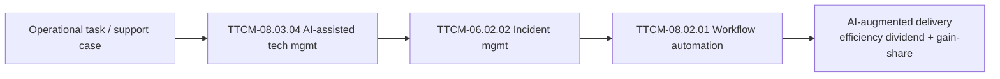
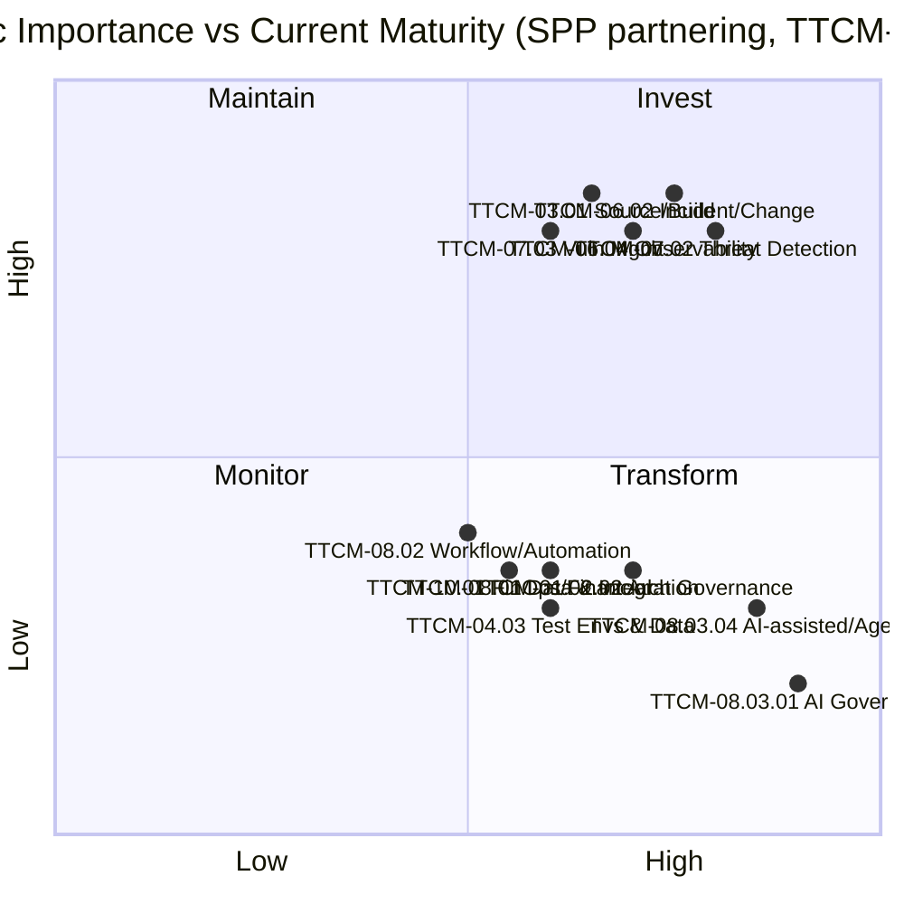
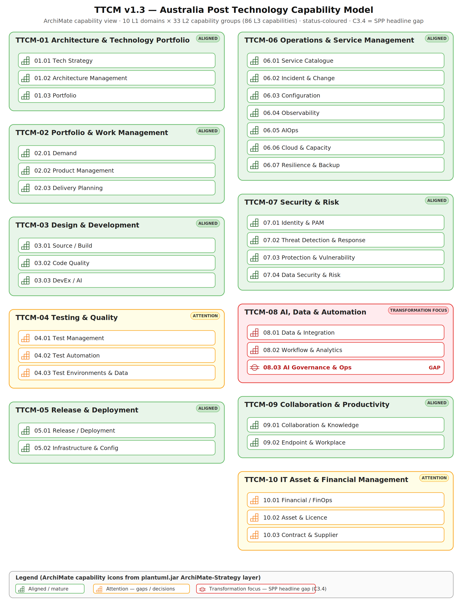

# Capability Model (Australia Post Technology Tool Capability Model - aligned)

> **Template Origin**: Official (ArcKit BPCM template) **re-baselined to the authoritative Australia Post Technology Tool Capability Model (TTCM) v1.3** | **ArcKit Version**: 1.30.0 | **Command**: `/arckit:business-capability-map`

## Document Control

| Field | Value |
|-------|-------|
| Document ID | ARC-001-BPCM-v1.0 |
| Document Type | Capability Model - aligned to Australia Post Technology Tool Capability Model (TTCM) v1.3 |
| Project | Australia Post - AusPost SPP (Managed Services Partnering Program) (Project 001) |
| Classification | AusPost Sensitive |
| Status | DRAFT |
| Version | 4.0 |
| Created Date | 2026-11-24 |
| Last Modified | 2026-11-25 |
| Review Cycle | Monthly during active ADM cycle |
| Next Review Date | 2026-12-24 |
| Owner | Terry Zhou, Enterprise Architect |
| Reviewed By | PENDING |
| Approved By | PENDING |
| Distribution | Program Team, Steering Committee, Enterprise Architecture Team, CTAIO |

### Revision History

| Version | Date | Author | Description | Reviewer | Approver |
|---------|------|--------|-------------|----------|----------|
| 1.0 | 2026-11-24 | ArcKit AI | Initial creation - 7-domain / 27-sub-cap business capability map (C1.0-C7.0), grounded on ADMP scope/drivers + 85-tool rationalised portfolio (vendors/scores.json) | PENDING | PENDING |
| 2.0 | 2026-11-24 | ArcKit AI | **Re-baselined the capability hierarchy to the authoritative Australia Post Technology Tool Capability Model (TTCM) v1.3** - 10 L1 domains / 33 L2 groups / 86 L3 capabilities (IT4IT 3.x-aligned, maturity 0-5 + criticality C1-C4). Re-anchored all AusPost-specific analysis (maturity S3, BR traceability S5, EP alignment S6, value streams S2, tool mapping S7) to TTCM capability IDs. 70 estate tools map to a TTCM L3 capability; 15 are business applications / enabling platforms / network infrastructure (dependencies, per TTCM S2 scope). | PENDING | PENDING |
| 3.0 | 2026-11-25 | ArcKit AI | **Rebased S7 tool mapping on the authoritative 174-tool estate register** (Source/Tools.md, intake source updated from Notion) — all 174 entries accommodated: 170 map to a primary L3 capability, 4 are out-of-scope (3 business apps + 1 enabling platform, dependencies S8.10). Preserves the 85-tool raw scores + rationalisation decisions (vendors/scores.json). Retires the earlier 85-tool-only S7 view. | PENDING | PENDING |
| 4.0 | 2026-11-25 | ArcKit AI | **Added a genuine ArchiMate capability-map diagram** (`diagrams/ARC-001-BPCM-archimate-capability-model.svg` / `.png`) - 10 L1 domains x 33 L2 capability groups with the native ArchiMate **capability** corner icon (extracted from `plantuml.jar` ArchiMate-Strategy layer), status-coloured, C3.4 headline gap marked. The native jar (v1.2026.10) does not render ArchiMate corner icons, so the diagram is hand-authored SVG + cairosvg render; the existing PlantUML block is retained as the structured text source (icon-less). | PENDING | PENDING |

---

## Intake Inputs (derived from artefacts)

| Intake Question | Answer |
|-----------------|--------|
| Business outcomes | Partnered run/change operating model; $22.2M FY30 bankable benefits; NPV ~$25M; AI-first run model [BC-C14/C16/C17] (STKE goals G-1..G-8) |
| Capability model | **Australia Post Technology Tool Capability Model (TTCM) v1.3** - 10 L1 domains / 33 L2 groups / 86 L3 capabilities (authoritative source: `Notion/AusPost/SPP/Source/Technology-Capability-Model.md`) |
| Current capabilities | **174-tool authoritative register** (`Source/Tools.md`); 170 tools map to a TTCM L3 capability, 4 are business applications / enabling platforms (dependencies; S8.10). 85 of the register were also scored in `vendors/scores.json`. Maturity assessed per S3 |
| Gaps | 10 capability gaps + 5 pending platform decisions (TTCM S11 146-needs assessment, Appendix C). Headline gaps: AI governance & model/agent inventory (TTCM-08.03.01); test-environment + test-data management (TTCM-04.03.01/02); progressive delivery & rollback (TTCM-05.02.02); technology financial planning + tool utilisation (TTCM-10.01.01/03); exit/portability (TTCM-10.03.03) |
| Value stream | 5 SPP value streams mapped to TTCM capabilities (S2) |
| Target state | Partnering / AI-first target state; owners per capability domain (S8 Traceability) |
| Capability depth | Level 3 (TTCM L3 capabilities = working granularity; the TTCM's 86 L3 caps are the authoritative working level) |

---

## 0. Alignment Basis

> This capability model is **aligned to the authoritative Australia Post Technology Tool Capability Model (TTCM) v1.3**.

**Authoritative source**: `Notion/AusPost/SPP/Source/Technology-Capability-Model.md` (TTCM v1.3 - 10 L1 domains / 33 L2 groups / 86 L3 capabilities, IT4IT 3.x-aligned, maturity scale 0-5 + criticality C1-C4).

**Scope note (per TTCM S2)**: The TTCM covers **technology-tooling capabilities** - the capabilities used to design, build, operate, secure, govern and manage the technology estate. It **excludes** business applications (e.g. Adobe Commerce, Genesys contact centre, Post Plus POS, Salesforce Marketing Cloud), shared technology platforms recorded only as dependencies (e.g. EDAP/EDP/IDG/ODS data platforms, Salesforce Data 360, MegaPort/ADC network infrastructure), and product-embedded tooling included only where material. Business applications and enabling platforms appear in S7 with **no primary L3 capability** (primary = `-`) - their controls are realised through the mapped TTCM L3 capability (monitoring, governance, integration).

**v1.0 -> v2.0 domain crosswalk** (legacy C-domain -> TTCM domain):

| v1.0 domain | v1.0 name | v2.0 TTCM domain(s) |
|---|---|---|
| C1.0 | Enterprise Architecture & Governance | `TTCM-01` Architecture & Technology Portfolio (+ `TTCM-02` portfolio/work mgmt, `TTCM-10.01.03` value) |
| C2.0 | Product & Service Delivery | `TTCM-03` Design & Development + `TTCM-04` Testing & Quality + `TTCM-05` Release & Deployment (+ `TTCM-08.01.02` integration) |
| C3.0 | Intelligent & AI-Enabled Operations | `TTCM-08` AI, Data & Automation (+ `TTCM-03.03` dev-ex AI) |
| C4.0 | Security, Privacy & Compliance | `TTCM-07` Security & Risk |
| C5.0 | Data & Analytics | `TTCM-08` AI, Data & Automation (data & integration) + `TTCM-08.02.02` analytics |
| C6.0 | Customer & Commerce | **Excluded from TTCM scope** (business applications) - realised as dependencies via `TTCM-08.03.04` (Agentforce), `TTCM-06.04.02` (monitoring) |
| C7.0 | Operations, Automation & Service Mgmt | `TTCM-06` Operations & Service Mgmt + `TTCM-09` Collaboration & Productivity + `TTCM-10` IT Asset & Financial Mgmt (+ `TTCM-08.02.01` automation) |

**Why re-baseline**: The v1.0 business capability map (C1.0-C7.0) was ArcKit-generated. The TTCM v1.3 is the **official, endorsed AusPost technology capability taxonomy** (IT4IT-aligned, with the estate's own tools named as representative examples). Aligning to it makes the capability model the single source of truth for capability IDs, and lets the 85-tool estate, BR traceability and EP alignment be re-anchored to the official capability IDs.

---

## 1. Capability Model (TTCM v1.3)

> Transcribed from the authoritative source. L3 capability **definitions** live in the source (not repeated here); IDs and names below are the working vocabulary. Status flag = **GAP** (no representative tool) or **DECISION** (pending platform decision) per TTCM S11 / Appendix C.

### Level 1: Capability Domains (10)

| ID | Capability domain | L2 groups | L3 capabilities | IT4IT alignment | Accountable group |
|---|---|---:|---:|---|---|
| `TTCM-01` | Architecture & Technology Portfolio | 3 | 6 | Evaluate / Explore | Enterprise Architecture / Technology Strategy |
| `TTCM-02` | Demand & Portfolio Management | 3 | 7 | Evaluate / Explore | Portfolio and Delivery Governance |
| `TTCM-03` | Design & Development | 3 | 7 | Integrate / Deploy | Engineering Platforms and Practices |
| `TTCM-04` | Testing & Quality | 3 | 8 | Integrate / Deploy / Release | Quality Engineering |
| `TTCM-05` | Release & Deployment | 2 | 6 | Deploy / Release | Release and Environment Management |
| `TTCM-06` | Operations & Service Management | 7 | 22 | Deploy / Release / Consume / Operate | Enterprise Service Management / SIAM; Technology Operations / SRE; Cloud, Infrastructure and Workplace Technology |
| `TTCM-07` | Security & Risk | 4 | 10 | Integrate / Deploy / Consume / Operate | Cyber Security and Identity |
| `TTCM-08` | AI, Data & Automation | 3 | 9 | Supporting all value streams | Technology Data, Integration, Automation and AI Governance |
| `TTCM-09` | Collaboration & Productivity | 2 | 3 | Evaluate / Explore / Deploy / Release / Consume / Operate | Portfolio and Delivery Governance; Enterprise Service Management / SIAM; Cloud, Infrastructure and Workplace Technology |
| `TTCM-10` | IT Asset & Financial Management | 3 | 8 | Evaluate / Consume / Supporting | Technology Finance, Commercial, ITAM and SAM |

### Level 2 / Level 3: Capability Hierarchy Detail (33 L2 groups / 86 L3 capabilities)

#### TTCM-01 — Architecture & Technology Portfolio

| L2 group | L3 capability | Status flag |
|---|---|---|
| `01.01` Technology Strategy & Roadmap | `TTCM-01.01.01` Technology strategy and principles | — |
|  | `TTCM-01.01.02` Investment and roadmap governance | — |
| `01.02` Architecture Management & Conformance | `TTCM-01.02.01` Enterprise and domain architecture management | — |
|  | `TTCM-01.02.02` Architecture decision and conformance management | — |
| `01.03` Portfolio & Standards Management | `TTCM-01.03.01` Application and technology portfolio management | — |
|  | `TTCM-01.03.02` Technology standards and lifecycle management | — |

#### TTCM-02 — Demand & Portfolio Management

| L2 group | L3 capability | Status flag |
|---|---|---|
| `02.01` Demand & Prioritisation | `TTCM-02.01.01` Demand intake and triage | — |
|  | `TTCM-02.01.02` Prioritisation, funding and benefits realisation | — |
| `02.02` Product & Work Management | `TTCM-02.02.01` Product and service portfolio management | — |
|  | `TTCM-02.02.02` Backlog, requirements and work management | DECISION: enterprise delivery platform |
| `02.03` Delivery Planning & Governance | `TTCM-02.03.01` Delivery planning and dependency management | — |
|  | `TTCM-02.03.02` Delivery governance and reporting | — |
|  | `TTCM-02.03.03` Delivery resource and capacity management | GAP |

#### TTCM-03 — Design & Development

| L2 group | L3 capability | Status flag |
|---|---|---|
| `03.01` Source, Build & Artefact Management | `TTCM-03.01.01` Source-code and version management | — |
|  | `TTCM-03.01.02` Build and continuous integration | — |
|  | `TTCM-03.01.03` Artefact and package management | — |
| `03.02` Code Quality & API Engineering | `TTCM-03.02.01` Code quality and secure engineering | — |
|  | `TTCM-03.02.02` API, event and interface engineering | — |
| `03.03` Developer Experience & AI Assistance | `TTCM-03.03.01` Developer experience and inner source | — |
|  | `TTCM-03.03.02` Engineering productivity and AI assistance | — |

#### TTCM-04 — Testing & Quality

| L2 group | L3 capability | Status flag |
|---|---|---|
| `04.01` Test Management & Quality Assurance | `TTCM-04.01.01` Test strategy and management | — |
|  | `TTCM-04.01.02` Defect management and quality analytics | — |
|  | `TTCM-04.01.03` Quality gates and release assurance | — |
| `04.02` Test Automation & Performance | `TTCM-04.02.01` Functional test automation | GAP: Salesforce-aware test automation |
|  | `TTCM-04.02.02` Non-functional testing | — |
| `04.03` Test Environments & Data | `TTCM-04.03.01` Test-environment management | GAP |
|  | `TTCM-04.03.02` Test-data management and masking | GAP |
|  | `TTCM-04.03.03` Service virtualisation and synthetic test data | — |

#### TTCM-05 — Release & Deployment

| L2 group | L3 capability | Status flag |
|---|---|---|
| `05.01` Release & Deployment Automation | `TTCM-05.01.01` Release planning and orchestration | DECISION: standard Salesforce DevOps toolchain |
|  | `TTCM-05.01.02` Change enablement integration | — |
| `05.02` Infrastructure & Configuration as Code | `TTCM-05.02.01` Deployment automation | — |
|  | `TTCM-05.02.02` Progressive delivery and rollback | GAP |
|  | `TTCM-05.02.03` Infrastructure and configuration as code | — |
|  | `TTCM-05.02.04` Environment and configuration management | — |

#### TTCM-06 — Operations & Service Management

| L2 group | L3 capability | Status flag |
|---|---|---|
| `06.01` Service Catalogue & Fulfilment | `TTCM-06.01.01` Service portfolio, catalogue and offer management | — |
|  | `TTCM-06.01.02` Request and fulfilment management | — |
|  | `TTCM-06.01.03` Service introduction and operational readiness | — |
| `06.02` Incident, Problem & Change | `TTCM-06.02.01` Change enablement | — |
|  | `TTCM-06.02.02` Incident and major incident management | — |
|  | `TTCM-06.02.03` Problem and known-error management | — |
| `06.03` Configuration & Service Levels | `TTCM-06.03.01` Configuration and service model management | — |
|  | `TTCM-06.03.02` Service-level and supplier performance management | — |
| `06.04` Observability & Monitoring | `TTCM-06.04.01` Telemetry collection and management | — |
|  | `TTCM-06.04.02` Application and digital experience monitoring | GAP: SEO / search performance monitoring |
|  | `TTCM-06.04.03` Infrastructure, cloud and network monitoring | — |
|  | `TTCM-06.04.04` Operational scheduling and workload monitoring | — |
| `06.05` AIOps & Ops Automation | `TTCM-06.05.01` Event correlation and alert-to-incident automation | — |
|  | `TTCM-06.05.02` Operational analytics and AIOps | — |
|  | `TTCM-06.05.03` Runbook and operations automation | — |
|  | `TTCM-06.05.04` Reliability and continual improvement | GAP |
| `06.06` Cloud Infrastructure & Capacity | `TTCM-06.06.01` Cloud and infrastructure provisioning | — |
|  | `TTCM-06.06.02` Capacity, performance and availability management | GAP |
| `06.07` Resilience & Recovery | `TTCM-06.07.01` Backup and restore management | — |
|  | `TTCM-06.07.02` Disaster recovery and continuity management | — |
|  | `TTCM-06.07.03` Technical recovery planning | — |
|  | `TTCM-06.07.04` Archiving and information lifecycle execution | GAP |

#### TTCM-07 — Security & Risk

| L2 group | L3 capability | Status flag |
|---|---|---|
| `07.01` Identity & Privileged Access | `TTCM-07.01.01` Identity lifecycle and access governance | — |
|  | `TTCM-07.01.02` Privileged access and remote administration | — |
|  | `TTCM-07.01.03` Secrets, certificates and key management | — |
| `07.02` Threat Detection & Response | `TTCM-07.02.01` Security information and event management | — |
|  | `TTCM-07.02.02` Cyber incident response and threat operations | — |
| `07.03` Protection & Vulnerability Management | `TTCM-07.03.01` Endpoint, workload, cloud and SaaS protection | — |
|  | `TTCM-07.03.02` Vulnerability and exposure management | — |
|  | `TTCM-07.03.03` Application and supply-chain security | — |
| `07.04` Data Protection, Risk & Compliance | `TTCM-07.04.01` Data protection, privacy and DLP | — |
|  | `TTCM-07.04.02` Security risk, compliance and assurance | — |

#### TTCM-08 — AI, Data & Automation

| L2 group | L3 capability | Status flag |
|---|---|---|
| `08.01` Data & Integration | `TTCM-08.01.01` Tool information architecture and authoritative data | DECISION: future MDM platform |
|  | `TTCM-08.01.02` Toolchain API, event and partner integration | DECISION: TIBCO successor + Layer 7 consolidation onto Kong |
|  | `TTCM-08.01.03` Data quality, reconciliation and lineage | — |
| `08.02` Workflow Automation & Analytics | `TTCM-08.02.01` Workflow automation and orchestration | DECISION: single RPA platform + Camunda successor |
|  | `TTCM-08.02.02` Reporting, analytics and decision intelligence | — |
| `08.03` AI Governance & Operations | `TTCM-08.03.01` AI governance and model/agent inventory | GAP |
|  | `TTCM-08.03.02` AI evaluation, safety and AgentOps | — |
|  | `TTCM-08.03.03` AI gateway, metering and policy enforcement | — |
|  | `TTCM-08.03.04` AI-assisted technology management | — |

#### TTCM-09 — Collaboration & Productivity

| L2 group | L3 capability | Status flag |
|---|---|---|
| `09.01` Collaboration & Knowledge | `TTCM-09.01.01` Collaboration and delivery knowledge | — |
|  | `TTCM-09.01.02` Knowledge management | — |
| `09.02` Endpoint & Workplace Technology | `TTCM-09.02.01` Endpoint and workplace technology management | — |

#### TTCM-10 — IT Asset & Financial Management

| L2 group | L3 capability | Status flag |
|---|---|---|
| `10.01` Technology Financial Management & FinOps | `TTCM-10.01.01` Technology financial planning and budgeting | GAP |
|  | `TTCM-10.01.02` Cloud and technology FinOps | — |
|  | `TTCM-10.01.03` Tool utilisation and value management | GAP |
| `10.02` IT Asset & Licence Management | `TTCM-10.02.01` Technology asset management | — |
|  | `TTCM-10.02.02` Software asset and licence management | — |
| `10.03` Contract & Supplier Management | `TTCM-10.03.01` Contract and commercial management | — |
|  | `TTCM-10.03.02` Supplier and ecosystem performance management | — |
|  | `TTCM-10.03.03` Exit, portability and provider replaceability | GAP |

### Capability Scales (TTCM Appendix D / E)

**Maturity scale (Appendix D, 0-5)**

| Level | Name | Meaning |
|:---:|------|---------|
| 0 | Absent | Capability not present in the estate |
| 1 | Initial / Ad-hoc | Capability exists but is ad-hoc, undocumented, tooling absent |
| 2 | Defined / Managed | Documented locally; partial tooling |
| 3 | Established / Standardised | Standardised, integrated tooling in place |
| 4 | Quantitatively Managed | Measured, controlled, evidence-based |
| 5 | Optimising | Continuously improving; industry-leading practice |

**Criticality scale (Appendix E, C1-C4)**

| Level | Name | Meaning |
|:---:|------|---------|
| C1 | Critical | Business-critical / high-risk; loss would materially disrupt operations |
| C2 | High | Significant operational or regulatory impact |
| C3 | Medium | Moderate impact; workaround available |
| C4 | Low | Minor impact; easily substituted |

> Capability-to-tool mapping follows the TTCM's eight mapping rules (source S10); each estate tool is mapped to its **primary** L3 capability (strongest control realisation) with secondary capabilities noted where the tool also supports them. The source's "Representative tools" column (naming the estate's own tools per L3 cap) is the anchor for S7.

---

## 2. Value Streams

> Five SPP value streams, re-anchored to TTCM capability IDs.

### Value Stream Matrix

| Value Stream | TTCM capabilities (flow) | Trigger | Outcome |
|--------------|-------------------------|---------|---------|
| VS-001 Architecture Governance | `TTCM-01.02.01` -> `TTCM-01.02.02` -> `TTCM-01.03.01` | New capability / change request | Governed architecture decision entered into the portfolio |
| VS-002 Digital Product Delivery | `TTCM-03.01.01` -> `TTCM-03.01.02` -> `TTCM-04.02.01` -> `TTCM-05.01.01` | Product requirement / feature request | Production-ready, secured release |
| VS-003 AI-Enabled Service Delivery | `TTCM-08.03.04` -> `TTCM-06.02.02` -> `TTCM-08.02.01` | Operational task / support case | AI-augmented service delivery; efficiency dividend + gain-share realised [BC-C14] |
| VS-004 Customer Service & Commerce | (business applications - dependencies) -> controls via `TTCM-08.03.04` (Agentforce) + `TTCM-06.04.02` (monitoring) | Customer enquiry / order | Resolved customer request; unified customer view |
| VS-005 Security & Compliance Response | `TTCM-07.02.01` -> `TTCM-07.01.01` -> `TTCM-07.04.02` | Threat event / audit finding | Incident contained; compliance maintained |

### Value Stream Flow (VS-003 - AI-Enabled Service Delivery, key SPP driver)

---
## 3. Capability Maturity Assessment

> Scale: TTCM Appendix D (0-5). Current maturity inferred from tool scores (vendors/scores.json) + TTCM S11 gap/decision signals. Target maturity reflects the partnering / AI-first target state. Assessed at the L2 group level (the TTCM does not assign per-L3 maturity).

| L2 group | Capability | Current | Target | Gap / rationale | Priority |
|----------|------------|:-------:|:------:|-----------------|----------|
| `01.01` | Technology Strategy & Roadmap | 3 | 4 | Strategy docs + LeanIX/Shibumi in place | Low |
| `01.02` | Architecture Mgmt & Conformance | 2 | 4 | Governance/conformance tooling weak (LeanIX/Signavio partial) | High |
| `01.03` | Portfolio & Standards Mgmt | 3 | 4 | LeanIX portfolio register mature | Low |
| `02.01` | Demand & Prioritisation | 3 | 4 | Shibumi benefits + Jira demand intake | Low |
| `02.02` | Product & Work Mgmt | 2 | 4 | No unified delivery platform (DECISION pending) | High |
| `02.03` | Delivery Planning & Governance | 3 | 4 | Shibumi/Confluence planning; `02.03.03` resource mgmt = GAP | Medium |
| `03.01` | Source, Build & Artefact | 4 | 5 | GitLab + CI mature | Low |
| `03.02` | Code Quality & API Engineering | 3 | 4 | Snyk/Secure Code Warrior + Kong | Medium |
| `03.03` | DevEx & AI Assistance | 3 | 4 | Copilot/Claude adopted | Low |
| `04.01` | Test Mgmt & QA | 3 | 4 | Test-automation tooling in place | Medium |
| `04.02` | Test Automation & Performance | 2 | 4 | `04.02.01` Salesforce-aware test automation = GAP | High |
| `04.03` | Test Environments & Data | 1 | 4 | `04.03.01` test-env + `04.03.02` test-data = GAP | High |
| `05.01` | Release & Deployment Automation | 3 | 4 | RevTrack SAP + ServiceNow change; Salesforce DevOps = DECISION | Medium |
| `05.02` | Infra & Config as Code | 3 | 4 | Terraform/CloudFormation; `05.02.02` progressive delivery/rollback = GAP | Medium |
| `06.01` | Service Catalogue & Fulfilment | 4 | 5 | ServiceNow catalogue/myIT + Front Door | Low |
| `06.02` | Incident, Problem & Change | 5 | 5 | ServiceNow ITSM 16/42 = strongest asset | Low |
| `06.03` | Configuration & Service Levels | 4 | 5 | ServiceNow CMDB mature | Low |
| `06.04` | Observability & Monitoring | 4 | 5 | New Relic/Sumo/ThousandEyes mature; `06.04.02` SEO = GAP | Low |
| `06.05` | AIOps & Ops Automation | 2 | 4 | ServiceNow ITOM/EvM partial; `06.05.04` reliability/CI = GAP | High |
| `06.06` | Cloud Infrastructure & Capacity | 2 | 4 | Provisioning via Terraform; `06.06.02` capacity mgmt = GAP | High |
| `06.07` | Resilience & Recovery | 3 | 4 | Backup/DR in place; `06.07.04` archiving = GAP | Medium |
| `07.01` | Identity & Privileged Access | 3 | 4 | IGA/PAM/CIAM + certs fragmented | Medium |
| `07.02` | Threat Detection & Response | 4 | 5 | Sentinel/Defender/MDR/Dragos mature | Low |
| `07.03` | Protection & Vuln Mgmt | 4 | 5 | Tenable/Nucleus/AssetNote/Wiz/Snyk mature | Low |
| `07.04` | Data Protection, Risk & Compliance | 3 | 4 | Purview/DLP/Macie + Protecht GRC | Low |
| `08.01` | Data & Integration | 2 | 4 | Collibra/Informatica/Confluent fragmented; MDM + Layer7/TIBCO = DECISION | High |
| `08.02` | Workflow Automation & Analytics | 2 | 4 | RPA + BI weak; single-RPA + Camunda = DECISION | High |
| `08.03` | AI Governance & Operations | 1 | 4 | `08.03.01` AI-governance register = GAP; Vertex AI/Agentforce emerging | High |
| `09.01` | Collaboration & Knowledge | 4 | 4 | Confluence/SharePoint/Teams/ServiceNow KM mature | Low |
| `09.02` | Endpoint & Workplace Tech | 3 | 4 | Omnissa VDI in place | Low |
| `10.01` | Tech Financial Mgmt & FinOps | 2 | 4 | Cloudability in place; `10.01.01` financial planning + `10.01.03` tool utilisation = GAP | High |
| `10.02` | IT Asset & Licence Mgmt | 2 | 4 | ServiceNow ITAM/SAM partial | Medium |
| `10.03` | Contract & Supplier Mgmt | 2 | 4 | Ariba + LawVu partial; `10.03.03` exit/portability = GAP | Medium |

**Maturity summary (current, by level)**

| Level | L2 groups (current) | Reading |
|:---:|---|---------|
| 5 (Optimising) | 1 (`06.02` Incident/Problem/Change) | ServiceNow ITSM estate - strongest asset |
| 4 (Quantitatively Managed) | 7 (`03.01`, `06.01`, `06.03`, `06.04`, `07.02`, `07.03`, `09.01`) | Mature dev, observability, security, collaboration |
| 3 (Established) | 13 (`01.01`, `01.03`, `02.01`, `02.03`, `03.02`, `03.03`, `04.01`, `05.01`, `05.02`, `06.07`, `07.01`, `07.04`, `09.02`) | Standardised, integrated |
| 2 (Defined) | 10 (`01.02`, `02.02`, `04.02`, `06.05`, `06.06`, `08.01`, `08.02`, `10.01`, `10.02`, `10.03`) | Documented locally - biggest gap cluster |
| 1 (Initial) | 2 (`04.03`, `08.03`) | Ad-hoc / no tooling - AI governance + test data |

**Headline gaps (High priority, low current maturity)**: `01.02` Arch governance, `02.02` delivery platform, `04.02`/`04.03` test automation + environments/data, `06.05`/`06.06` AIOps + capacity, `08.01` data/integration, `08.02` workflow automation/analytics, `08.03` **AI governance & operations** (the key SPP gap, mirrors the v1.0 C3.4 finding), `10.01` tech financial planning/FinOps.

---
## 4. Capability Heatmap

> x = Strategic Importance (low -> high); y = Current Maturity (low -> high). Re-anchored to TTCM L3 capability IDs.

**Reading the heatmap**: Quadrant-1 (Invest) = `TTCM-08.03` AI governance/operations, `TTCM-01.02.02` arch governance, `TTCM-08.01` data & integration, `TTCM-04.03` test environments/data, `TTCM-10.01` financial mgmt - high strategic importance but low current maturity. These are the transformation priorities the SPP partnering programme targets. Quadrant-2 (Maintain) = the mature ServiceNow estate (incident/change, catalogue, CMDB), security (threat detection, vuln mgmt), and observability - protect these. Quadrant-4 (Transform) = `TTCM-08.02` workflow automation / RPA - a candidate for AI-augmented automation/offloading.

---

## 5. Capability-Requirement Traceability

> Traces the **12 Evaluate-Phase business requirements** in `ARC-001-REQ-v1.0.md` (BR-001..BR-012) to the **TTCM capabilities** that support them. Provides REQ -> TTCM capability -> tool traceability.

| REQ BR | Requirement (from REQ) | Supporting TTCM capabilities | Coverage |
|--------|------------------------|------------------------------|----------|
| BR-001 | RFP Scope & Structure endorsed (pre-market BC) | `TTCM-01.02.01`, `TTCM-01.02.02`, `TTCM-06` (service mgmt) | Partial |
| BR-002 | Single strategic partner selected via single RFP | `TTCM-01.02.02`, `TTCM-01.03.01` | Partial - program-level |
| BR-003 | Gain-share contract structure | `TTCM-10.01.03`, `TTCM-10.01.02` | Partial |
| BR-004 | 40% efficiency dividend captured on transitioned services | `TTCM-10.01.03`, `TTCM-08.02.01`, `TTCM-10.01.02` | Partial - benefits-realisation tooling gap (`10.01.03` GAP) |
| BR-005 | 24-month phased transition executable | `TTCM-06`, `TTCM-05` | Partial |
| BR-006 | Bankable benefit case realised by FY30 | `TTCM-10.01.03`, `TTCM-10.01.02` | Partial - benefits tooling gap |
| BR-007 | Knowledge transfer completed before SME attrition | `TTCM-09.01.02`, `TTCM-08.01.01` | Partial - documentation-first |
| BR-008 | Stakeholder readiness baseline (plan + union agreement) | Program-level (not a TTCM business capability) | Gap |
| BR-009 | Zero unplanned service continuity breaches during transition | `TTCM-07.02.02`, `TTCM-07.03.02`, `TTCM-06.04.02` | Full |
| BR-010 | Regulatory compliance maintained (incl. offshore) | `TTCM-07.04.02`, `TTCM-07.04.01`, `TTCM-08.01` | Full |
| BR-011 | AI-first operations under the partner model | `TTCM-08.03` (AI governance & operations) | Partial - `08.03.01` AI-governance gap |
| BR-012 | Cloud cost management (FinOps) for partner workloads | `TTCM-10.01.02` | Full |

**Coverage summary**: Full = 3 (BR-009, BR-010, BR-012), Partial = 8, Gap = 1 (BR-008 - program-level stakeholder readiness, not a TTCM capability).

> Note: BR-004 and BR-006 both depend on `TTCM-10.01.03` tool utilisation & value management, which the TTCM flags as a **GAP** - the benefits-realisation tooling gap persists in the re-baselined model.

---
## 6. Enterprise Principles Alignment

> Traces the 12 **Enterprise Principles** (EP01-EP10 official + P9/P10 SPP-specific) to the TTCM capabilities that realise them.

| Principle | Description | Realising TTCM capabilities | Alignment | Notes |
|-----------|-------------|------------------------------|-----------|-------|
| EP01 | Business First | `TTCM-01.03.01`, `TTCM-06` (service mgmt) | Aligned | Business-led service design |
| EP02 | Target First | `TTCM-01.02.01`, `TTCM-08.02.02` | Aligned | Outcomes drive investment |
| EP03 | User First | (business apps - dependencies) via `TTCM-08.03.04`, `TTCM-06.04.02` | Aligned | Customer experience via Agentforce + monitoring |
| EP04 | Buy Over Build | `TTCM-01.03.01`, `TTCM-10.01.03` | Aligned | Sourcing + value mgmt |
| EP05 | Cloud First | `TTCM-10.01.02`, `TTCM-03.01.02` | Partial | FinOps (Cloudability) + dev; capacity mgmt gap |
| EP06 | API First | `TTCM-08.01.02`, `TTCM-03.02.02` | Partial | Fragmented API estate (Kong/Layer7/Axway = DECISION) |
| EP07 | Data Is Our Lifeblood | `TTCM-08.01`, `TTCM-07.04.01`, `TTCM-08.01.01` | Partial | Data governance (Collibra/Informatica fragmented) |
| EP08 | Industry Leading Practices | `TTCM-03.01.02`, `TTCM-06.04` | Aligned | CI + observability |
| EP09 | Least Privilege Access | `TTCM-07.01`, `TTCM-03.02.01` | Aligned | IGA/PAM + code security |
| EP10 | Internet-Scale NFRs | `TTCM-03.01`, `TTCM-07.02.02`, `TTCM-06.04` | Aligned | Resilient design + detection |
| P9 | Partner-Ready Service Design (SPP) | `TTCM-06`, `TTCM-01.02.02` | Aligned | Service catalogue + arch governance for partner handover |
| P10 | AI-Assisted Operations (SPP) | `TTCM-08.03` | Partial | `08.03.01` AI-governance gap |

**Alignment summary**: Aligned = 8 (EP01, EP02, EP03, EP04, EP08, EP09, EP10, P9), Partial = 4 (EP05, EP06, EP07, P10).

**Key finding (confirmed on re-baseline)**: The **AI-first principle (P10) maps to `TTCM-08.03` AI Governance & Operations**, which the TTCM assesses at current maturity 1 (Initial) with `08.03.01` (AI governance & model/agent inventory) flagged as a **GAP** - the single biggest principle-capability gap. This is the headline SPP transformation need, now anchored to an official capability ID.

---

## 7. Tool-to-Capability Mapping (Full Register — 174 tools)

> Source: `Obsidian Vault/Notion/AusPost/SPP/Source/Tools.md` — the **authoritative estate register (174 entries)**, intake source updated 2026-11-25. This supersedes the earlier 85-tool `vendors/scores.json` mapping; the scores file remains the source of record for the raw 1–20 scores and Keep/Consolidate/Defer/Retire decisions of the 85 rationalised tools (recorded at portfolio granularity).

**Coverage: 170 of 174 register entries map to a primary L3 capability.** The remaining 4 are out of TTCM scope (3 business applications + 1 enabling platform) and are accommodated as dependencies (S8.10). Every register entry is accommodated.

| Tool ID | Tool | Owner (HoT) | Primary L3 capability | Secondary L3 capability(s) |
|---------|------|-------------|----------------------|----------------------------|
| 1 | SAP LeanIX | Gurchan | TTCM-01.03.01 | TTCM-01.01.01, TTCM-01.01.02, TTCM-01.02.01, TTCM-01.02.02, TTCM-01.03.02 |
| 2 | Shibumi | — | TTCM-02.01.02 | TTCM-01.01.02, TTCM-02.03.02, TTCM-06.01.03 |
| 3 | Jira | Steven V | TTCM-02.02.02 | TTCM-02.01.01, TTCM-02.03.01 |
| 4 | Confluence | Steven V | TTCM-09.01.01 | TTCM-02.03.02, TTCM-09.01.02 |
| 5 | Miro | — | TTCM-09.01.01 | TTCM-02.02.02, TTCM-02.03.01 |
| 6 | Lucidchart | — | TTCM-01.02.01 | — |
| 7 | Microsoft Visio | Adam G | TTCM-01.02.01 | — |
| 8 | draw.io | — | TTCM-01.02.01 | — |
| 9 | SharePoint | Adam G | TTCM-09.01.01 | TTCM-09.01.02 |
| 10 | SAP Signavio | — | TTCM-01.02.01 | TTCM-02.03.01 |
| 11 | Smartsheet | — | TTCM-02.02.02 | TTCM-02.03.01 |
| 12 | Asana | — | TTCM-02.02.02 | — |
| 13 | GitLab | Steven V | TTCM-03.01.01 | TTCM-03.01.02, TTCM-05.01.01 |
| 14 | GitHub | Steven V | TTCM-03.01.01 | — |
| 15 | GitLab CI | Steven V | TTCM-03.01.02 | TTCM-05.01.01, TTCM-05.02.01 |
| 16 | GitLab Runners | Steven V | TTCM-03.01.02 | TTCM-05.02.01 |
| 17 | Jenkins | — | TTCM-03.01.02 | TTCM-05.01.01, TTCM-05.02.01 |
| 18 | Sonatype Nexus | Steven V | TTCM-03.01.03 | — |
| 19 | Apache Maven | Steven V | TTCM-03.01.02 | — |
| 20 | RevTrack | — | TTCM-05.01.01 | TTCM-06.02.01 |
| 21 | Bitbucket | Retails ...? | TTCM-03.01.01 | — |
| 22 | Visual Studio Code | Steven V | TTCM-03.03.01 | — |
| 23 | IntelliJ IDEA | Steven V | TTCM-03.03.01 | — |
| 24 | PyCharm | Steven V | TTCM-03.03.01 | — |
| 25 | DBeaver | Adam G or Steven V | TTCM-03.03.01 | — |
| 26 | DbVisualizer | — | TTCM-03.03.01 | — |
| 27 | HeidiSQL | Steven V | TTCM-03.03.01 | — |
| 28 | MySQL Workbench | Steven V | TTCM-03.03.01 | — |
| 29 | SonarQube | Steven V | TTCM-03.02.01 | TTCM-07.03.03 |
| 30 | Snyk | Sam Julien | TTCM-07.03.03 | TTCM-03.02.01 |
| 31 | 1Password | Greg Couper | TTCM-07.01.03 | — |
| 32 | GVP Secrets | — | TTCM-07.01.03 | — |
| 33 | AWS Secrets Manager | Adam G. | TTCM-07.01.03 | — |
| 34 | Azure Key Vault | Adam G | TTCM-07.01.03 | — |
| 35 | GitLab Secrets Management | Steven V | TTCM-07.01.03 | — |
| 36 | Terraform | Steven V | TTCM-05.02.03 | TTCM-06.06.01 |
| 37 | AWS CloudFormation | Adam G | TTCM-05.02.03 | TTCM-06.06.01 |
| 38 | Azure Automation | Adam G | TTCM-05.02.04 | TTCM-06.05.03 |
| 39 | PractiTest | Lisa T. | TTCM-04.01.01 | TTCM-04.01.02, TTCM-04.01.03 |
| 40 | Selenium | Lisa T. | TTCM-04.02.01 | — |
| 41 | Playwright | Lisa T. | TTCM-04.02.01 | — |
| 42 | Cypress | Lisa T. | TTCM-04.02.01 | — |
| 43 | Applitools | — | TTCM-04.02.01 | TTCM-04.02.02 |
| 44 | TestMu / LambdaTest | Lisa T. | TTCM-04.02.01 | — |
| 45 | Cucumber | Steven V | TTCM-04.02.01 | — |
| 46 | JUnit | Steven V | TTCM-04.02.01 | — |
| 47 | Jest | Steven V | TTCM-04.02.01 | — |
| 48 | Mockito | Steven V | TTCM-04.02.01 | — |
| 49 | BrowserStack | Steven V or Lisa T. | TTCM-04.02.01 | — |
| 50 | BlazeMeter | Steven V or Lisa T. | TTCM-04.02.02 | — |
| 51 | Gatling | Steven V or Lisa T. | TTCM-04.02.02 | — |
| 52 | Grafana k6 | Steven V or Lisa T. | TTCM-04.02.02 | — |
| 53 | Karate | Steven V or Lisa T. | TTCM-04.02.01 | — |
| 54 | Postman | Steven V | TTCM-04.02.01 | — |
| 55 | Cyara Velocity | Lisa T. | TTCM-04.02.01 | TTCM-04.03.03 |
| 56 | MailSlurp | Lisa T. | TTCM-04.03.03 | — |
| 57 | UiPath Test Cloud | Lisa T. | TTCM-04.02.01 | — |
| 58 | Perfecto | Lisa T. | TTCM-04.02.01 | — |
| 59 | Mountebank | Steven V | TTCM-04.03.03 | — |
| 60 | Tonic / Delphix | Lisa T. | TTCM-04.03.02 | TTCM-07.04.01 |
| 61 | IBM DataStage | Lisa T. | TTCM-04.03.02 | TTCM-08.01.02 |
| 62 | Article ID Generator † | — | TTCM-04.03.03 | — |
| 63 | My Post Account Generator † | — | TTCM-04.03.03 | — |
| 64 | TIBCO Connectors † | — | TTCM-08.01.02 | — |
| 65 | Retail Transaction Generator † | — | TTCM-04.03.03 | — |
| 66 | ServiceNow ITSM | Paul Ed. | TTCM-06.02.02 | TTCM-06.02.01, TTCM-06.02.03, TTCM-06.01.02 |
| 67 | ServiceNow CMDB | Paul Ed. | TTCM-06.03.01 | TTCM-06.05.02 |
| 68 | ServiceNow Service Catalogue / myIT | Paul Ed. | TTCM-06.01.01 | TTCM-06.01.02 |
| 69 | ServiceNow Demand Management | Paul Ed. | TTCM-02.01.01 | TTCM-02.01.02 |
| 70 | ServiceNow Knowledge Management | Paul Ed. | TTCM-09.01.02 | TTCM-09.01.01 |
| 71 | ServiceNow ITOM | Paul Ed. | TTCM-06.05.02 | TTCM-06.03.01, TTCM-06.05.01 |
| 72 | ServiceNow Performance Analytics | Paul Ed. | TTCM-06.03.02 | TTCM-10.03.02 |
| 73 | ServiceNow DevOps / Change Velocity | Paul Ed. | TTCM-05.01.02 | TTCM-06.02.01 |
| 74 | ServiceNow IntegrationHub | Paul Ed. | TTCM-08.02.01 | TTCM-08.01.02 |
| 75 | ServiceNow On-Call Scheduling | Paul Ed. | TTCM-06.02.02 | — |
| 76 | ServiceNow ITAM | Paul Ed. | TTCM-10.02.01 | — |
| 77 | ServiceNow SAM | Paul Ed. | TTCM-10.02.02 | — |
| 78 | ServiceNow Now Assist | Paul Ed. | TTCM-08.03.04 | — |
| 79 | New Relic | Steven V | TTCM-06.04.02 | TTCM-08.03.02, TTCM-06.05.01 |
| 80 | Sumo Logic | Steven V | TTCM-06.04.01 | TTCM-06.04.02 |
| 81 | ThousandEyes | Adam G. | TTCM-06.04.02 | TTCM-06.04.03 |
| 82 | AppDynamics | Adam G. | TTCM-06.04.02 | — |
| 83 | Site24x7 | Adam G. | TTCM-06.04.03 | — |
| 84 | Oracle Enterprise Manager | Adam G. | TTCM-06.04.03 | — |
| 85 | AWS CloudWatch | Adam G. | TTCM-06.04.03 | — |
| 86 | AWS CloudTrail | Adam G. | TTCM-06.04.01 | — |
| 87 | Azure Monitor | Adam G. | TTCM-06.04.03 | — |
| 88 | Azure Log Analytics / Activity Log | Adam G. | TTCM-06.04.01 | — |
| 89 | Google Cloud Monitoring | Adam G. | TTCM-06.04.03 | — |
| 90 | Google Cloud Logging | Adam G. | TTCM-06.04.01 | — |
| 91 | Microsoft Entra ID | Greg Couper | TTCM-07.01.01 | — |
| 92 | SailPoint IdentityIQ / AccessNow | Greg Couper | TTCM-07.01.01 | — |
| 93 | CyberArk Privileged Cloud | Greg Couper | TTCM-07.01.02 | — |
| 94 | CyberArk Remote Access | Greg Couper | TTCM-07.01.02 | — |
| 95 | Microsoft Entra PIM | Greg Couper | TTCM-07.01.02 | — |
| 96 | Quest Active Roles | Greg Couper | TTCM-07.01.01 | — |
| 97 | Quest Recovery Manager | Greg Couper | TTCM-06.07.01 | — |
| 98 | Silverfort | Greg Couper | TTCM-07.01.01 | — |
| 99 | Microsoft Sentinel | Sam | TTCM-07.02.01 | — |
| 100 | Microsoft Defender Suite | Amanda | TTCM-07.02.02 | TTCM-07.03.01 |
| 101 | Microsoft Defender for Cloud | Amanda | TTCM-07.03.01 | — |
| 102 | Microsoft Defender Vulnerability Management | Amanda | TTCM-07.03.02 | — |
| 103 | SentinelOne | Sam | TTCM-07.03.01 | — |
| 104 | Tenable | Sam | TTCM-07.03.02 | — |
| 105 | Nucleus | Sam | TTCM-07.03.02 | TTCM-07.03.03 |
| 106 | AssetNote | Sam | TTCM-07.03.02 | — |
| 107 | Wiz | Adam G. | TTCM-07.03.01 | — |
| 108 | Dragos | Sam | TTCM-07.02.02 | — |
| 109 | Microsoft Purview | Sam | TTCM-07.04.01 | TTCM-07.04.02 |
| 110 | Google Cloud DLP | Adam G | TTCM-07.04.01 | — |
| 111 | Amazon Macie | Adam G | TTCM-07.04.01 | — |
| 112 | AWS Security Hub | Adam G | TTCM-07.03.01 | — |
| 113 | Google Security Command Center | Adam G ? | TTCM-07.03.01 | — |
| 114 | Airlock | Amanda | TTCM-07.03.01 | — |
| 115 | Entrust | Greg C | TTCM-07.01.03 | — |
| 116 | DigiCert | Greg C or Sam | TTCM-07.01.03 | — |
| 117 | Microsoft AD PKI / Cloud PKI | Greg C | TTCM-07.01.03 | — |
| 118 | AWS Certificate Manager | Adam G | TTCM-07.01.03 | — |
| 119 | Google Certificate Manager | Adam G | TTCM-07.01.03 | — |
| 120 | Microsoft KMS | Adam G | TTCM-07.01.03 | — |
| 121 | AWS KMS | Adam G | TTCM-07.01.03 | — |
| 122 | Google Cloud KMS | Adam G | TTCM-07.01.03 | — |
| 123 | Microsoft Intune | HoT of EUC | TTCM-09.02.01 | — |
| 124 | Microsoft Configuration Manager / SCCM | Adam G | TTCM-09.02.01 | — |
| 125 | VMware Workspace ONE UEM | HoT of EUC | TTCM-09.02.01 | — |
| 126 | Apple Business Manager | HoT of EUC | TTCM-09.02.01 | — |
| 127 | Samsung Knox | HoT of EUC | TTCM-09.02.01 | — |
| 128 | Managed Google Play | HoT of EUC | TTCM-09.02.01 | — |
| 129 | SOTI MobiControl | HoT of EUC | TTCM-09.02.01 | — |
| 130 | Commvault / Cloud EBR | Adam G | TTCM-06.07.01 | TTCM-06.07.02 |
| 131 | Dell DDPS | Adam G. | TTCM-06.07.01 | — |
| 132 | AWS Backup | Adam G | TTCM-06.07.01 | — |
| 133 | Azure Backup | Adam G | TTCM-06.07.01 | — |
| 134 | Azure Recovery Services | Adam G | TTCM-06.07.02 | — |
| 135 | Azure Backup Server | Adam G | TTCM-06.07.01 | — |
| 136 | Google Cloud Backup and DR | Adam G. | TTCM-06.07.02 | TTCM-06.07.01 |
| 137 | Symantec Backup Exec | Adam G? | TTCM-06.07.01 | — |
| 138 | SyncBack | Adam G? | TTCM-06.07.01 | — |
| 139 | Kong Enterprise | Steven V | TTCM-03.02.02 | TTCM-08.01.02, TTCM-08.03.03, TTCM-10.01.02 |
| 140 | Confluent Kafka / management tooling | Steven V | TTCM-08.01.02 | TTCM-06.05.01 |
| 141 | MuleSoft | Matt Brown | TTCM-08.01.02 | — |
| 142 | Azure Integration Cloud management tooling | Steven V | TTCM-08.01.02 | — |
| 143 | NGIP management tooling | Steven V | TTCM-08.01.02 | TTCM-06.05.01 |
| 144 | TIBCO management tooling | Retail ?? | TTCM-08.01.02 | — |
| 145 | CA/Broadcom Layer 7 | Steven V | TTCM-08.01.02 | — |
| 146 | APST | Steven V | TTCM-08.01.02 | — |
| 147 | Axway | — | TTCM-08.01.02 | — |
| 148 | Business Connect | — | TTCM-08.01.02 | — |
| 149 | Collibra | — | TTCM-08.01.01 | TTCM-08.01.03 |
| 150 | ER/Studio | HoT of Data | TTCM-08.01.01 | TTCM-08.01.03 |
| 151 | Profisee SaaS | HoT of Data? | TTCM-08.01.01 | TTCM-08.01.03 |
| 152 | BigQuery management / FinOps functions | HoT of Data? | TTCM-10.01.02 | TTCM-07.04.01 |
| 153 | Dataform DataOps use | HoT of Data | TTCM-08.01.03 | TTCM-06.04.04 |
| 154 | Looker / LookML | HoT of Data | TTCM-08.02.02 | — |
| 155 | Power BI technology-management reporting | HoT of Data | TTCM-08.02.02 | — |
| 156 | Tableau technology-management reporting | Matt Brown | TTCM-08.02.02 | — |
| 157 | Neo4j conditional technology-management use | HoT of Data | TTCM-08.01.01 | — |
| 158 | Gemini Enterprise Agent Platform | HoT of Data | TTCM-08.03.04 | TTCM-08.03.01 |
| 159 | Microsoft Copilot technology-delivery use | HoT of EUC | TTCM-08.03.04 | — |
| 160 | GitHub Copilot | Steven V | TTCM-03.03.02 | TTCM-08.03.04 |
| 161 | Anthropic Claude | Steven V | TTCM-08.03.04 | — |
| 162 | Salesforce Agentforce | Matt Brown | TTCM-08.03.04 | TTCM-08.03.01 |
| 163 | Automation Anywhere | — | TTCM-08.02.01 | — |
| 164 | UiPath | — | TTCM-08.02.01 | — |
| 165 | Miro AI | HoT of Delivery? | TTCM-09.01.01 | — |
| 166 | GovernAI | — | TTCM-08.03.01 | — |
| 167 | Apptio Cloudability | Adam G. | TTCM-10.01.02 | — |
| 168 | ServiceNow ITAM | Paul Ed | TTCM-10.02.01 | — |
| 169 | ServiceNow SAM | Paul Ed | TTCM-10.02.02 | — |
| 170 | SAP Ariba | HoT of procurement? | TTCM-10.03.01 | TTCM-10.03.02 |
| 171 | ServiceNow HR Service Delivery (HRSD) ‡ | — | — | — |
| 172 | ServiceNow Employee Center Pro ‡ | — | — | — |
| 173 | ServiceNow Customer Service Management (CSM) ‡ | — | — | — |
| 174 | ServiceNow Now Platform § | Paul Ed | — | TTCM-06.02.02, TTCM-08.02.01 |

*† = register entry flagged "Not a tool" but named by the TTCM as a representative tool (synthetic-data generators → TTCM-04.03.03; TIBCO adapters → TTCM-08.01.02).
*‡ = business application (out of TTCM scope per S2); accommodated as a dependency.
*§ = shared enabling platform (out of TTCM scope per S2); underpins the ServiceNow modules (IDs 66–78).

**Coverage roll-up by primary capability (top 8):**

| Primary L3 capability | # tools |
|-----------------------|---------|
| TTCM-04.02.01 | 15 |
| TTCM-07.01.03 | 13 |
| TTCM-08.01.02 | 10 |
| TTCM-06.07.01 | 8 |
| TTCM-03.03.01 | 7 |
| TTCM-09.02.01 | 7 |
| TTCM-07.03.01 | 6 |
| TTCM-04.03.03 | 5 |
| *(remaining 46 capabilities)* | *99* |

### Key Coverage Observations

- **ServiceNow ecosystem is the operational backbone**: 13 ServiceNow modules (IDs 66–78) plus the Now Platform (174) span Operations (06), Security (07), Workflow/Integration (08) and Asset/Financial (10).
- **Test/Quality is the densest capability**: TTCM-04.02.01 (functional test automation) carries **15 tools** — the largest single-capability concentration in the estate.
- **Secrets, certificates & keys are second-densest**: TTCM-07.01.03 carries **13 tools** (1Password, cloud KMS/cert managers, Azure Key Vault, GVP Secrets, Entrust/DigiCert).
- **Integration spine**: TTCM-08.01.02 carries **10 tools** (Confluent Kafka, MuleSoft, TIBCO mgmt, APST, Axway, Business Connect, CA Layer 7, Azure Integration Cloud, NGIP).
- **Resilience breadth**: TTCM-06.07.01 (backup/restore) carries **8 tools** across AWS/Azure/GCP/on-prem (Commvault, Dell DDPS, AWS Backup, Azure Backup, Google Cloud Backup, Symantec, SyncBack, Quest).
- **Out-of-scope entries (4)**: ServiceNow HRSD / Employee Center Pro / CSM (business apps) + ServiceNow Now Platform (enabling platform) — all accommodated as dependencies in S8.10.
- **Scoring cross-reference**: 85 register tools were part of the rationalisation exercise (`vendors/scores.json`, scored 1–20, portfolio-granularity). 14 scored Retire, incl. Dell DDPS (3), Bitbucket (5), TIBCO mgmt tooling (5), Nucleus (5); several Azure/microsoft tools and the Salesforce-aware test-env gap informed S3 maturity.

## 8. Traceability & Dependencies

| Capability domain (TTCM) | Related Artefact | Type | Owner |
|--------------------------|------------------|------|-------|
| `TTCM-01` Architecture & Technology Portfolio | ARC-001-PRIN-v1.0.md (EP01/EP02/EP04/EP05) | Principle | Enterprise Architecture |
| `TTCM-01` / `TTCM-02` | ARC-001-APPY-v1.0.md (application landscape) | Application Landscape | Enterprise Architecture |
| `TTCM-03` / `TTCM-04` / `TTCM-05` | ARC-001-TRC-v1.0.md (BR-001..BR-012) | Business Requirement | Business / CTAIO |
| `TTCM-06` / `TTCM-10` | ARC-001-SOW-v1.0.md (partnering scope) | SOW | CTAIO |
| `TTCM-07` | ARC-001-SOW-v1.0.md (security annex) | SOW | Security |
| `TTCM-08` AI, Data & Automation | ARC-001-PRIN-v1.0.md (P10 AI-Assisted Ops); ARC-001-TRC-v1.0.md (BR-011) | Principle / Requirement | CTAIO / EA |
| `TTCM-10` value | ARC-001-EVAL-v1.0.md (financial model, gain-share) | Evaluate | CTAIO |
| (Authoritative source) | `Notion/AusPost/SPP/Source/Technology-Capability-Model.md` (TTCM v1.3) | Capability Model | Enterprise Architecture |

**Dependencies**: This model inherits the capability hierarchy from the authoritative TTCM v1.3. The 174-tool estate register (Source/Tools.md; 85 of which were scored in vendors/scores.json), BR set (ARC-001-TRC-v1.0.md), EP set (ARC-001-PRIN-v1.0.md), application landscape (ARC-001-APPY-v1.0.md), and financial model (ARC-001-EVAL-v1.0.md) feed the S2-S7 analysis.

**Open items / follow-ups**:
1. Confirm owner per TTCM domain (S8 currently PENDING) - assign accountable group per L1 domain.
2. Reconcile the v1.0 C-domain ID references in downstream artefacts (ADMP, BR traceability) to TTCM IDs where they cite capability IDs.
3. Validate the maturity assessments in S3 against the partner's current-state capability assessment (single partner).
4. P9/P10 SPP-specific principles carry no official EP number - confirm their disposition vs the EP01-EP10 register.

---
## Capability Map Diagram (ArchiMate)

> **Genuine ArchiMate capability model** - 10 L1 domains x 33 L2 capability groups (86 L3 capabilities), status-coloured, with the C3.4 headline gap (TTCM-08.03 AI Governance/Ops) marked. Every capability element carries the native ArchiMate **capability** corner icon (extracted from `plantuml.jar` -> `sprites/archimate/strategy-capability.svg`; the gap element uses the ArchiMate `gap-filled.svg` icon).
>
> **Source**: `diagrams/ARC-001-BPCM-archimate-capability-model.svg` - **Generator**: `diagrams/_gen_archimate_capability_model.py` - **Rendered**: cairosvg. *Note: the native PlantUML jar (v1.2026.10) does render ArchiMate capability icons via `<<$cap>>` (as SVG `<path>` elements), but its force layout lays this 10-domain model out wide/short (single row); the hand-authored SVG gives a clean 2-column grid with per-L2 status coloring. The PlantUML block below is the structured source.*

*Legend: Green = aligned/mature - Yellow = attention (gaps/decisions) - Red = transformation focus (TTCM-08 AI, Data & Automation - headline SPP gap, C3.4).*

### Structured PlantUML source (icon-less in v1.2026.10 jar)

```plantuml
@startuml
!theme plain
skinparam linetype ortho
skinparam defaultFontSize 11
skinparam roundCorner 8
skinparam nodesep 18
skinparam rankseparatorscale 22
sprite $cap jar:archimate/strategy-capability

rectangle "TTCM v1.3 - Australia Post Technology Capability Model (10 L1 domains x 33 L2)" {
  rectangle "TTCM-01\nArchitecture & Technology\nPortfolio" #E8F5E9 {
    rectangle "01.01 Tech Strategy\n01.02 Architecture Mgmt\n01.03 Portfolio" <<$cap>>
  }
  rectangle "TTCM-02\nPortfolio & Work Mgmt" #E8F5E9 {
    rectangle "02.01 Demand\n02.02 Product Mgmt\n02.03 Delivery Planning" <<$cap>>
  }
  rectangle "TTCM-03\nDesign & Development" #E8F5E9 {
    rectangle "03.01 Source / Build\n03.02 Code Quality\n03.03 DevEx / AI" <<$cap>>
  }
  rectangle "TTCM-04\nTesting & Quality" #FFF9C4 {
    rectangle "04.01 Test Mgmt\n04.02 Test Automation\n04.03 Test Envs/Data" <<$cap>>
  }
  rectangle "TTCM-05\nRelease & Deployment" #E8F5E9 {
    rectangle "05.01 Release / Deploy\n05.02 Infra / Config" <<$cap>>
  }
  rectangle "TTCM-06\nOperations & Service Mgmt" #C8E6C9 {
    rectangle "06.01 Service Catalogue\n06.02 Incident/Change\n06.03 Config\n06.04 Observability\n06.05 AIOps\n06.06 Cloud/Capacity\n06.07 Resilience" <<$cap>>
  }
  rectangle "TTCM-07\nSecurity & Risk" #C8E6C9 {
    rectangle "07.01 Identity/PAM\n07.02 Threat Det/Resp\n07.03 Protection/Vuln\n07.04 Data/Risk/Compliance" <<$cap>>
  }
  rectangle "TTCM-08\nAI, Data & Automation" #FFCDD2 {
    rectangle "08.01 Data & Integration\n08.02 Workflow/Analytics\n08.03 AI Governance/Ops\n(GAP 08.03.01)" <<$cap>>
  }
  rectangle "TTCM-09\nCollaboration & Productivity" #E8F5E9 {
    rectangle "09.01 Collab & Knowledge\n09.02 Endpoint/Workplace" <<$cap>>
  }
  rectangle "TTCM-10\nIT Asset & Financial Mgmt" #FFF9C4 {
    rectangle "10.01 Financial/FinOps\n10.02 Asset/Licence\n10.03 Contract/Supplier" <<$cap>>
  }
}
@enduml
```

*Legend: Green = aligned/mature; Yellow = attention (gaps/decisions); Red = transformation focus (AI, Data & Automation - headline SPP gap).*

---
*Document generated by ArcKit v1.30.0 - command `/arckit:business-capability-map`, re-baselined to Australia Post Technology Tool Capability Model v1.3. Next steps: (1) assign accountable owner per TTCM L1 domain; (2) reconcile downstream artefacts (ADMP/BR) from legacy C-domain IDs to TTCM IDs; (3) validate S3 maturity against single-partner current-state assessment; (4) confirm P9/P10 SPP-principle disposition.*
